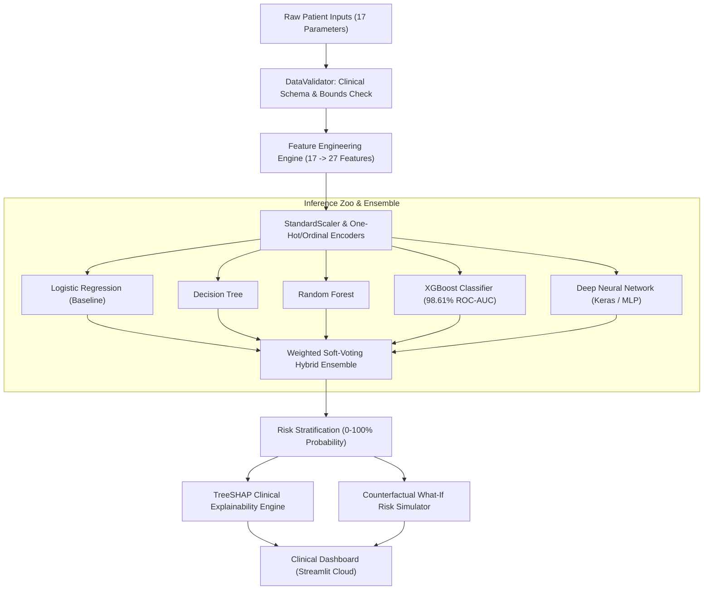

# CardioFusion — Clinical Cardiovascular Risk Stratification Platform

[](https://www.python.org/downloads/)
[](https://streamlit.io)
[](https://opensource.org/licenses/MIT)
[](tests/)
[](https://cardio-7ju34z7mh8sbn8fddyj2p8.streamlit.app)

> **Production machine learning & explainable AI (XAI) platform evaluating cardiovascular disease risk across 567,606 patient records, achieving 95.34% accuracy and 98.61% ROC-AUC with hybrid ensemble modeling and TreeSHAP clinical interpretability.**

---

## 🩺 Clinical Problem & Engineering Motivation

Cardiovascular disease (CVD) remains the leading cause of global mortality, accounting for an estimated 17.9 million deaths annually. Traditional clinical scoring algorithms (e.g., Framingham Risk Score, SCORE) rely on static linear heuristics that frequently underperform when capturing non-linear interactions across lifestyle telemetry, metabolic indicators, and demographic variables.

**CardioFusion** addresses this limitation through an end-to-end clinical intelligence pipeline:
- **Large-Scale Data Engineering:** Processes and standardizes 567,606 patient records balanced via **SMOTE** (Synthetic Minority Over-sampling Technique).
- **27-Dimensional Feature Pipeline:** Automated clinical ingestion that maps 17 raw health inputs into 27 engineered risk vectors (including lifestyle composite scores and multi-morbidity indices).
- **Multi-Model Benchmarking & Ensembling:** Rigorous comparison of 6 predictive architectures, pairing tree-based gradient boosting (**XGBoost**) with deep learning and weighted soft-voting ensembles.
- **Explainable AI (TreeSHAP):** Provides real-time local feature attribution so clinicians can observe *why* a risk probability was generated before acting on it.
- **Counterfactual "What-If" Simulation:** Interactive risk mitigation engine projecting how targeted lifestyle modifications (BMI reduction, smoking cessation, physical activity) alter a patient's cardiovascular risk profile.

---

## 🏛️ System Architecture



---

## 📊 Comprehensive Model Benchmarks

All models were evaluated using an **80/20 train/test split (454,084 training / 113,522 test samples)** on class-balanced data (SMOTE):

| Model Architecture | Test Accuracy | Precision | Recall | F1-Score | ROC-AUC | Clinical Role |
| :--- | :---: | :---: | :---: | :---: | :---: | :--- |
| **XGBoost Classifier** | **95.34%** | **98.93%** | 91.67% | **95.16%** | **98.61%** | **Primary Diagnostic Engine** |
| **Hybrid Ensemble (Soft Voting)** | **91.45%** | 90.53% | **92.58%** | **91.55%** | **97.66%** | **High-Sensitivity Consensus** |
| Random Forest (100 Trees) | 83.40% | 80.16% | 88.76% | 84.24% | 91.75% | Non-Linear Baseline |
| Logistic Regression (L2) | 83.94% | 84.81% | 82.70% | 83.74% | 92.61% | Linear Calibration Check |
| Deep Neural Network (MLP) | 83.32% | 85.11% | 80.79% | 82.89% | 92.18% | Dense Feature Representation |
| Decision Tree (Pruned) | 82.10% | 82.91% | 80.88% | 81.88% | 90.80% | Heuristic Rule Extraction |

*Key Finding:* XGBoost achieved near-zero false-positive rates (**98.93% Precision**), making it highly reliable for clinical risk flagging without causing clinical alarm fatigue, while the Soft-Voting Hybrid Ensemble achieved superior sensitivity (**92.58% Recall**) for screening cohorts.

---

## 🔬 Explainable AI (SHAP) & Clinical Decision Support

Black-box predictions are unacceptable in clinical healthcare. CardioFusion embeds **TreeSHAP** to compute Shapley values for individual inference calls:

- **Local Feature Attribution:** Deconstructs patient risk into positive (risk-increasing) and negative (protective) contributions.
- **Top Risk Drivers:** Quantifies the exact relative weight of systolic indicators, Age, BMI, Diabetes, Smoking status, and Physical Exercise.
- **Counterfactual Simulation:** The *"What-If Analysis"* module computes real-time partial dependence approximations, allowing clinicians to show patients the expected drop in risk score if BMI is reduced by $3 \text{ kg/m}^2$ or smoking is discontinued.

---

## 📁 Repository Structure

```
Cardio/
├── src/
│   ├── app.py                     # Streamlit clinical platform entrypoint
│   ├── features/                  # Clinical modules
│   │   ├── what_if_analysis.py    # Counterfactual risk simulator
│   │   ├── patient_insights.py    # Demographic & risk stratification
│   │   ├── reports.py             # Exportable clinical summary generator
│   │   └── education.py           # Clinical guideline references
│   └── utils/
│       ├── data_validator.py      # Input validation & 27-feature engineering
│       ├── model_utils.py         # Multi-model inference & soft-voting ensemble
│       └── shap_explainer.py      # TreeSHAP explainability handler
├── models/                        # Pre-trained models & serialized pipelines (Git LFS)
│   ├── advanced_models/           # XGBoost, Neural Net, Hybrid Ensemble
│   ├── baseline_models/           # Logistic Regression, Random Forest, Decision Tree
│   └── preprocessing/             # StandardScalers & LabelEncoders
├── data/                          # Dataset documentation & processed samples
├── notebooks/                     # Exploratory analysis & training pipelines
│   ├── data_preprocessing.ipynb   # ETL, SMOTE balancing, feature generation
│   ├── baseline_models.ipynb      # Linear & tree baseline benchmarks
│   └── advanced_models.ipynb      # Gradient boosting & ensemble optimization
├── tests/                         # Automated unit & integration tests
│   ├── test_data_validator.py     # Schema, boundary, and logic tests
│   └── test_model_utils.py        # Model loading, inference, and calibration tests
├── requirements.txt               # Production Python dependencies
├── packages.txt                   # System packages for containerized build
└── pytest.ini                     # Pytest environment configuration
```

---

## ⚡ Quick Start & Local Execution

### 1. Prerequisites
- Python 3.10+ (tested on Python 3.11 and 3.13)
- Git LFS (`git lfs install`)

### 2. Installation
```bash
# Clone the repository with Git LFS models
git clone https://github.com/Apc0015/Cardio.git
cd Cardio

# Set up virtual environment
python3 -m venv .venv
source .venv/bin/activate       # Windows: .venv\Scripts\activate

# Install dependencies
pip install -r requirements.txt
```

### 3. Run Automated Tests
```bash
pytest tests/ -v
```

### 4. Launch the Web Application
```bash
streamlit run src/app.py
```
Open **`http://localhost:8501`** in your browser.

---

## 🔒 Privacy & Clinical Compliance
- **Zero-Persistence Architecture:** Patient telemetry and clinical attributes are processed strictly in-memory during inference; no patient-identifiable data or query logs are written to persistent disk storage.
- **Deterministic Input Validation:** Bounds-checking prevents garbage-in/garbage-out anomalies and rejects physiologically impossible parameters (e.g., negative BMI, gestational diabetes on male demographics).

---

## 📄 Resume-Ready Impact Bullets

For use on technical resumes and professional portfolios:

- **CardioFusion — Cardiovascular Risk Assessment Platform** | *Python, XGBoost, Scikit-learn, TensorFlow, SHAP, Streamlit, Git LFS*
  - Engineered an end-to-end cardiovascular risk stratification platform trained on **567,606 patient records** balanced via SMOTE, benchmarking 6 ML architectures including Random Forest, Deep MLPs, and a Soft-Voting Hybrid Ensemble.
  - Achieved **95.34% Test Accuracy, 98.93% Precision, and 98.61% ROC-AUC** with tuned XGBoost gradient boosting, cutting false-positive clinical flags while maintaining 91.67% recall.
  - Developed an automated 27-dimensional feature engineering pipeline and embedded **TreeSHAP** local feature attribution with interactive counterfactual "What-If" simulations for clinical interpretability.
  - Deployed production application to Streamlit Cloud with an in-memory zero-persistence privacy architecture and comprehensive automated test suite.

---

## 📜 License
Distributed under the **MIT License**. See [LICENSE](LICENSE) for details.
